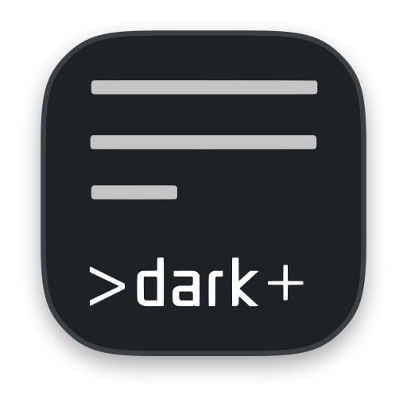

<div align="center">

</div>

# 🌙Dark+ (Modified)

A dark theme (which also supports light mode, can you imagine that ~) of [SiYuan Note](https://github.com/siyuan-note/siyuan).

Modified for personal use.

## Installation

Clone into a folder named `Dark+Modified` inside SiYuan's themes folder (SiYuan requires the folder name to match
`name` in `theme.json`), then select the theme in Settings → Appearance:

```bash
git clone https://github.com/q0wkp/siyuan-theme-dark-plus.git "<THEMES_DIR>/Dark+Modified"
```

`<THEMES_DIR>` is `<workspace>/data/themes` since SiYuan v3.8.5, and `<workspace>/conf/appearance/themes` in
v3.8.3 and v3.8.4. For a fork, clone the fork's URL instead.

## Updating

```bash
git -C "<THEMES_DIR>/Dark+Modified" pull
```

### Reloading SiYuan automatically after an update

Run this once in the clone, and every open SiYuan window reloads by itself whenever a pull brings in changes:

```bash
git -C "<THEMES_DIR>/Dark+Modified" config core.hooksPath .githooks
```

It turns on the Git hook [`.githooks/post-merge`](./.githooks/post-merge), which writes `theme.css` (its content
stays the same) after each pull that changed something. SiYuan notices the write and tells its windows, and the
theme reloads them the way its "Reload the Window" button does. Nothing runs in between: no polling and no extra
connection.

- The windows have to be running a version of the theme that has this feature, so reload them by hand once after
  the pull that brings it in.
- Git runs the hook after `git pull` and `git merge`, not after `git reset`; run it by hand then:
  `sh "<THEMES_DIR>/Dark+Modified/.githooks/post-merge"`.
- To turn it off: `git -C "<THEMES_DIR>/Dark+Modified" config --unset core.hooksPath`.
- The hook is a POSIX shell script, so on Windows it needs Git for Windows' shell.
