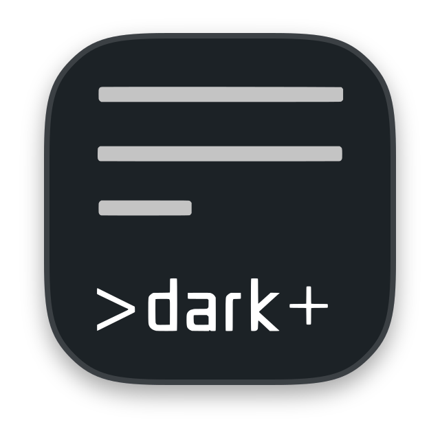

<div align="center">

</div>

# 🌙 Dark+ (Modified)

A dark theme (which also supports light mode, can you imagine that ~) of [SiYuan Note](https://github.com/siyuan-note/siyuan).

Modified for personal use.

## Installation

Clone into a folder named `Dark+Modified` inside SiYuan's themes folder (SiYuan requires the folder name to match
`name` in `theme.json`), then select the theme in Settings → Appearance:

```bash
git clone https://github.com/q0wkp/siyuan-theme-dark-plus.git "<THEMES_DIR>/Dark+Modified"
```

`<THEMES_DIR>` is `<workspace>/data/themes` since SiYuan v3.8.5, and `<workspace>/conf/appearance/themes` in
v3.8.3 and v3.8.4. For a fork, clone the fork's URL instead.

## Updating

```bash
git -C "<THEMES_DIR>/Dark+Modified" pull
```

### Reloading SiYuan automatically after an update

Run this once in the clone, and every open SiYuan window reloads by itself whenever a pull brings in changes:

```bash
git -C "<THEMES_DIR>/Dark+Modified" config core.hooksPath .githooks
```

It turns on the Git hook [`.githooks/post-merge`](./.githooks/post-merge), which writes `theme.css` (its content
stays the same) after each pull that changed something. SiYuan notices the write and tells its windows, and the
theme reloads them the way its "Reload the Window" button does. Nothing runs in between: no polling and no extra
connection.

- The windows have to be running a version of the theme that has this feature, so reload them by hand once after
  the pull that brings it in.
- Git runs the hook after `git pull` and `git merge`, not after `git reset`; run it by hand then:
  `sh "<THEMES_DIR>/Dark+Modified/.githooks/post-merge"`.
- To turn it off: `git -C "<THEMES_DIR>/Dark+Modified" config --unset core.hooksPath`.
- The hook is a POSIX shell script, so on Windows it needs Git for Windows' shell.

## Disclaimer

This project is not affiliated with, endorsed by, or sponsored by Dark+ or its maintainers. "Dark+" refers to the software developed by Zuoqiu Yingyi (https://github.com/Zuoqiu-Yingyi/siyuan-theme-dark-plus) and is referenced here solely for descriptive purposes.

This project is not affiliated with, endorsed by, or sponsored by SiYuan or its maintainers. "SiYuan" refers to the software developed by Yunnan Liandi Technology Co., Ltd. (https://github.com/siyuan-note/siyuan) and is referenced here solely for descriptive purposes.

## License

Copyright 2026 Tianyu (Sky) Lu

Except for the third-party code listed below, this repository is 
licensed under the GNU Affero General Public License, Version 3 (the 
"License"); you can redistribute and/or modify these files under the 
terms of version 3 of the License. You may obtain a copy of the License at

```plaintext
https://www.gnu.org/licenses/agpl-3.0.html
```

This program is distributed in the hope that it will be useful, but
WITHOUT ANY WARRANTY; without even the implied warranty of
MERCHANTABILITY or FITNESS FOR A PARTICULAR PURPOSE. See the License
for more details.

### Third-Party Code

This repository includes the following third-party code, which remains under its respective original licenses:

| Code | Included As | License | Copyright | Modified |
|------|-------------|---------|-----------|----------|
| [Dark+](https://github.com/Zuoqiu-Yingyi/siyuan-theme-dark-plus) | Forked from | [AGPL-3.0-only](LICENSES/Dark+-AGPL-3.0-only.txt) | Zuoqiu Yingyi | Yes |
| [siyuan-comment](https://github.com/langzhou/siyuan-note/tree/main/siyuan-comment) | Came with Dark+, in `app/comment` | No license stated | langzhou | Yes |
| Website and brand icons | Came with Dark+, in `icon` | No license stated; trademarks of their respective owners | Their respective owners | No |
| [Noto Color Emoji](https://github.com/googlefonts/noto-emoji) | Copied into `fonts` | [OFL-1.1](LICENSES/NotoColorEmoji-OFL-1.1.txt) | Copyright 2022 Google Inc. | No |

All other code in this repository, including changes made to the code 
above, is licensed under the GNU Affero General Public License, Version 3. The commit history of 
this repository, together with snippets and file headers marked in the 
source files, identifies which code belongs to which project. Files that 
contain code from more than one project are subject to all applicable 
licenses. Contributions to this repository are accepted only under the 
GNU Affero General Public License, Version 3 ("inbound = outbound" principle).
